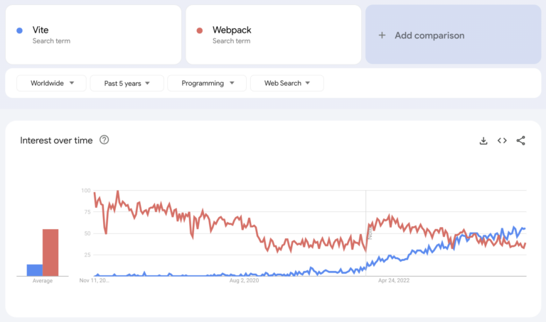
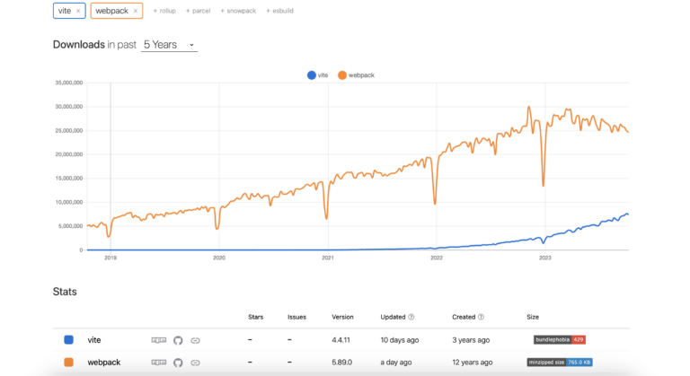
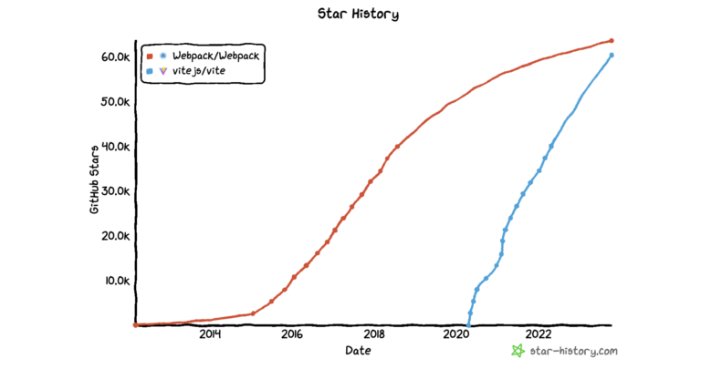
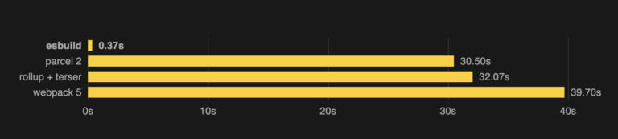
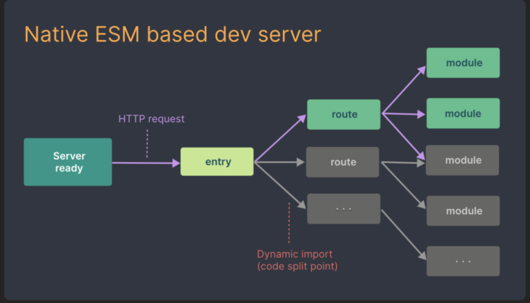
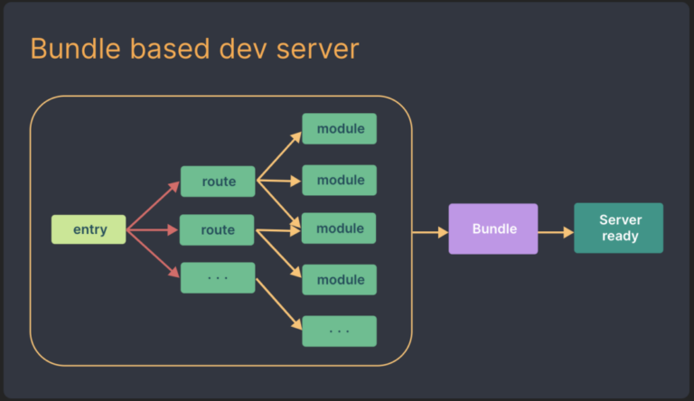
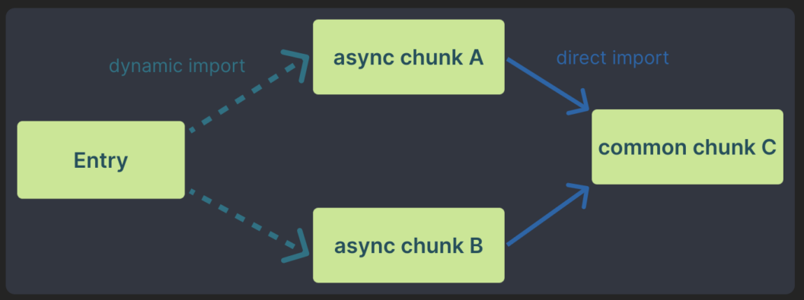

这是一篇译文，主要比较 vite 和 webpack 两者在构建方式、构建效率、应用场景等诸多方面的异同点，这是[原文地址](https://kinsta.com/blog/vite-vs-webpack/)

# Vite vs. Webpack 的全面比较

在现代前端动态变化的本质中，我们必须要记住`老的`(原文为 _old_)并不代表`过时的`(原文为 _outdated_)，而`新的`(原文为 _new_)也并不总是意味着`更好`(原文为 _better_)

选择正确技术的关键是它是不是能符合你项目的需求，这条原则在你研究 Javascript 打包工具的时候影响甚大。无论一个打包工具是经过了时间的检验，还是新出的，它们各自都有优势和局限。

这篇文章主要研究两个很重要的流行工具：Vite 和 Webpack。我们基于它们各自的特性、差异点、设计哲学，以及它们是如何集成进开发生态的这几个方面来评价它们

目录

- 什么是 Javascript 模块打包工具？(Javascript Module Bundler)
- Vite 与 Webpack：介绍与概览
- 两者异同点

## 什么是 Javascript 模块打包工具？(Javascript Module Bundler)

Javascript 打包工具(原文为 _bundler_) 是用来把多个 JS 文件组合成一个单一的文件的，这个单一的文件就是我们常说的 bundle。它通过减少你的 web 应用需要发出的请求数(通常是加载页面所需的资源数量，如 js/css/本地图片等，译者注)，以简化 JS 代码管理，以最终提升性能

举个栗子，假设我们有 2 个独立的 JS 文件：`module1.js` 和 `modules2.js`。

`module1.js` 如下：
```javascript
// module1.js
export const greet = (name) => {
    console.log(`Hello, ${name}!`);
}
```

`module2.js` 如下：
```javascript
// module2.js
export const farewell = (name) => {
    console.log(`Goodbye, ${name}!`);
}
```

为了把这两个文件打包成一个文件，你可以使用以下的打包工具，比如 Rollup、Webpack 或者 Parcel 之类的。具体来讲，如果你打算创建一个叫 `index.js` 的文件，如下所示：

```javascript
// index.js
import { greet } from './module1.js';
import { farewell } from './module2.js';

greet('Kinsta');
farewell('Server Troubles');
```

那么当使用打包工具的时候，它把 `module1.js`、`module2.js` 以及 `index.js` 合并起来，放进一个单独的、优化过的 bundle，这个 bundle 会根据 web 应用使用它们的方式进行裁剪

随着现代 web 浏览器开始支持 ES modules 和 HTTP/2 这些技术，也带来了请求开销逐步增加的焦虑，JS 打包工具在实现代码增强方面正在变得不可或缺。这些打包工具会执行必要的代码转换工作，包含代码的压缩简化、转化与优化工作

而且，JS 模块打包工具确保了不同浏览器的兼容性，它们帮助解决了不同浏览器的特定问题，并且无论用户选择了哪款浏览器，都保证了一致性的用户体验(bundler 应该只是解决了代码转换的部分，浏览器各自的 API 特性还是要专门解决，译者注)

这个打包的流程不只加快了 web 应用的加载速度，也保证了性能，特别是在生产环境的性能。现在你已经对 JS 打包工具以及它在 web 开发中的角色有了基本的认识，接下来我们把焦点转向 Vite 和 Webpack

## Vite 与 Webpack：介绍与概览

显而易见的是，Vite 和 Webpack 都在快速发展的现代 web 开发领域内处于领导地位，在这些领域内，资源管理和优化过的打包工具都是至关重要的。不过，在我们深入细节对比之前，我们先对这些打包工具有一个整体的认识，并好好理解一下是什么让它们脱颖而出。

### Vite: 快速且按需开发

[Vite](https://vite.dev/)，英文读作"veet"，为 web 开发者带来了全新的游戏规则，它把速度和效率放在更高的优先级上。让 Vite 脱颖而出的是它按需打包的处理方式。Vite 使用现代浏览器中的本地 ES 模块，直接在开发过程中就把代码提供给了浏览器,而不是提前打包好所有的代码和资产。这导致了几乎是立即响应的 HMR (Hot Module Replacement)，并且减少了冷启动的次数。

Vite 的开发服务器 (dev server) 在其按需打包方式的配合下同样表现不俗，它让开发者可以不用全量编译就能很快看到代码效果。它同样[使用了 Rollup](https://kinsta.com/blog/rollup-vs-webpack-vs-parcel/#rollup)，来实现高效的生产构建 (production build)。因此，Vite 提供了闪电般的开发体验以及可靠的生产性能。

### Webpack: 组织度与适应性

[Webpack](https://webpack.js.org/)则是作为现代 web 开发的基石，自 2012 年就开始稳定迭代进化。Webpack 的强大之处在于它管理组织网站组件的方式。它通过[模块化组织代码](https://auth0.com/blog/javascript-module-systems-showdown/)的方式来优化加载时间与用户体验。

Webpack 的超高适应性同样是其重要的优势。开发者可以根据简单或复杂的任务对项目进行定制化，它赋予开发者裁剪工作流并精准搭建 build 流程的能力。

## 两者异同点

现在我们已经初步了解了 Vite、Webpack 的基础概念，接下来我们继续探讨两者更细节的异同点。当我们分析这些打包工具的时候，我们会考察多个方面，从而全面对比，明确其各自的优势所在。

1. 架构与设计哲学
2. 流行程度、社区与生态
3. 配置与使用的难易
4. Dev Server
5. 构建时间与 bundle 大小
6. 构建优化
7. 静态资产的处理
8. 静态站点的支持
9. 服务端渲染(SSR)的支持
10. JSON 支持
11. Vue.js 与 JSX 支持
12. Typescript 支持
13. Glob 导入支持
14. Web Workers 支持
15. 第三方库的开发能力
16. 浏览器兼容性

### 1.  架构与设计哲学

这两种打包工具都提供了独特的打包与优化 web app 的想法。它们在对于插件的实现上具有共同之处，它们都允许社区[实现另外的有益插件](https://vite.dev/guide/api-plugin.html)，这些插件拓展了这两种打包工具的功能，并制作了各色各样的工具提供给开发者

Vite 的核心思想是简洁性和扩展性。它坚持最小化的策略，专注于开箱即用的、最常见的 web app 开发范式，它种方法保证了项目的长期可维护性。

Vite 依赖于[基于 rollup 的](https://rollupjs.org/)插件机制，这种方式通过外部插件来实现功能，以防止 Vite 本身的核心代码过度臃肿。因此，这实现了一个相对简洁的内核层，并鼓励形成有序维护的蓬勃发展的插件生态。另外，Vite 主动与 Rollup 项目合作以维护其兼容性、以及共享的插件生态体系。

Webpack 则是赋予了开发者自定义的能力，允许开发者根据特定需求裁剪项目，不论是基础任务还是复杂需求。它提供了配置构建流程所有方面的灵活性，使其成为那些寻找个性化开发体验开发者的首选。

而且，Webpack 还为 web 项目引入了[模块化的方式](https://webpack.js.org/concepts/modules/)，就像是搭建乐高积木那样。你代码仓库里的所有内容对于 Webpack 来说都可视作是一个模块，而且它可以用多种方式来呈现依赖关系。举几个例子：

1.  [ES2025](https://developer.mozilla.org/en-US/docs/Web/JavaScript/Reference/Statements/import) 的 `import` 语句
2.  [CommonJS](https://nodejs.org/api/modules.html#requireid) 的 `require()` 语句
3.  [AMD](https://github.com/amdjs/amdjs-api/blob/master/AMD.md) 的 `define` 和 `require` 语句
4.  **css/sass/less** 文件支持的 `@import` 语句
5.  样式表里的 image URL `url()` 或是 HTML 文件里的 `` 表达式

#### Vite 设计哲学的实践体现

Vite 这种保持简洁性和可扩展性的设计哲学体现在其构建 web 应用的方式。假设你正在开发一个 web 应用，并且想要用 Vite 使用现代 Javascript 特性，比如说 ES modules，你可以毫无压力地做到。比如下面这个简化的例子：

```js
// app.js
import { greet } from './utilities.js';

const worker = new Worker(new URL('./worker.js', import.meta.url));

// Simulate a calculation in the web worker
worker.postMessage({ input: 42 });

worker.onmessage = (e) => {
  const result = e.data.result;
  console.log(`Result from the web worker: ${result}`);
};

const message = greet('Hello, Vite!');
console.log(message);
```

在这个代码片段里，Vite 利用了 ES modules，并且顺畅、快速地对代码进行了打包，避免了开发过程中耗时的打包步骤。这种模块化的方法能够让你高效管理依赖，创建一个更加可维护的代码仓库。这展示了 Vite 致力于最小化原则，且开发者友好的体验。

#### Webpack 设计哲学的实践体现

Webpack 的模块化思想对于大规模的项目来说是特别有益的。比如说你正在开发一个庞大的 web 应用，它里面有多个 JS 模块，通过 Webpack 你可以无缝地组装这些模块，改善可读性、可维护性，以及网站加载时长。下面是一个简化了的例子：

```js
// webpack.config.js
const path = require('path');

module.exports = {
  entry: './app.js',
  output: {
    filename: 'bundle.js',
    path: path.resolve(__dirname, 'dist'),
  },
  module: {
    rules: [
      {
        test: /.js$/,
        use: 'babel-loader',
        exclude: /node_modules/,
      },
    ],
  },
};
```
在这个例子中，Webpack 让你能够配置构建流程、优化代码、高效处理资产。通过把你的项目组织成模块结构并使用[像 Babel 这样的 loader](https://babeljs.io/docs/#babel-is-a-javascript-compiler)，你能够写出整洁、模块化的代码以提升用户体验。这正说明了 Webpack 努力提供定制能力与灵活性，确保开发可以按需定制项目。

虽然 Vite 和 Webpack 都有各自独特的设计哲学，但它们都有一个共识，那就是延展现代 web 开发的边界。Vite 关注于现代的编码范式，推广代码的[ECMAScript Modules(ESM)](https://nodejs.org/api/esm.html)化，并鼓励现代化的标准，如 `new Worker` 句法。

另一方面，Webpack 则演化为了由 Node.js 和 CommonJS 带来的一系列挑战的解决方案，驱动着 web 开发中模块化的应用。Webpack 的自动依赖关系收集能力、连同性能提升一道，确保了舒适的开发者体验。

### 2.  普及程度、社区与生态

Vite 和 Webpack 有各自的时间趋势，这形成了它们的普及程度与社区。



> 上图为最近 5 年 Google Trends 上 Vite 与 Webpack 的比较

Vite 是新入局的玩家，[于 2020 年首次亮相](https://en.wikipedia.org/wiki/Vite_(software))。尽管时间不长，但很快就获得了大量关注，使其成为现代 web 开发领域一个颇具前景的参与者。

相比之下，Webpack 的开始则要早很多，在 2012 年就已创建。在那个时代，业界足以使其衍生出一个成熟的生态与健壮的社区了。


> Vite 与 Webpack 在 npmtrends 上最近 5 年的比较

上面这张来自[npmtrends](https://npmtrends.com/vite-vs-webpack)的图表呈现了 Vite 与 Webpack 的下载量对比。它很清晰地展示了 Webpack 一直在下载量方面保持着显著的优势，同时这张图也有力地体现了其长期存在，且在开发者社区中的使用程度。


> Vite 与 Webpack star 数历史的比较

当我们再关注它们在 Github 上的[star 数历史](https://www.star-history.com/#Webpack/Webpack&vitejs/vite&type=date&legend=top-left)，它也是一种流行度与社区支持的指标，我们发现 Vite 拥有惊人的 60,318 stars，而 Webpack 则维持着 63,958 stars。这里的 star 数反映了这两个项目的认可度。Vite 的快速增长与 Webpack 一直保持的广泛流行使得它们在 web 开发蓝图中都占有一席之地。

### 3.  配置与使用的难易程度

Vite 和 Webpack 都提供了大量的配置选项，以便让开发者按需定制。但是，这其中有很大差异，值得关注。接下来让我们研究一下这两个工具的配置与使用难易程度。

#### Vite 的极简配置

Vite 通过其零配置的设计思路把它自己分离出来，这种设计是为了简化开发流程。这意味着你可以用最小的代价创建一个基础的 Vue 3 组件库。这里是一个简单的[vue 配置](https://vite.dev/config/)项目的例子：

```js
import { defineConfig } from 'vite'
import vue from '@vitejs/plugin-vue'

export default defineConfig({
  plugins: [vue()],
})
```

在上面的例子中，我们只 import 并安装了[Vite 为 Vue.js 写的官方插件](https://www.npmjs.com/package/@vitejs/plugin-vue)，Vite 的神奇之处在于其能自动检测对于大多数项目正确的配置。

#### Webpack 的配置复杂程度

另一方面，Webpack 则倾向于要求更细节的配置项。尽管在最新的版本中它已经向零配置的方式进行了努力，但还是不如 Vite 那么傻瓜。比如说对于 Vue 3，一份基础的 Webpack 配置项可能如下所示：

```js
const webpack = require('webpack');
const path = require('path');
const { HotModuleReplacementPlugin } = require('webpack');
const { VueLoaderPlugin } = require('vue-loader');

module.exports = {
    entry: './src/main.js',
    output: {
        path: path.resolve(__dirname, './build'),
        filename: 'bundle.js',
    },
    module: {
        rules: [
            {
                test: /.js$/,
                exclude: /(node_modules|bower_components)/,
                use: {
                    loader: 'babel-loader',
                    options: {
                        presets: ['@babel/preset-env'],
                    },
                },
            },
            {
                test: /.vue$/,
                use: {
                    loader: 'vue-loader',
                },
            },
            {
                test: /.css$/,
                use: ['vue-style-loader', 'css-loader'],
            },
        ],
    },
    resolve: {
        alias: {
            vue: 'vue/dist/vue.js',
        },
    },
    plugins: [
    new HotModuleReplacementPlugin(),
    new VueLoaderPlugin(),
    ]
};
```
当你和 Vite 比较的时候，[Webpack 的配置](https://github.com/persteenolsen/webpack-5-vue-boilerplate/tree/master/config)包含了更多的手动配置项。这些复杂度包括了指定 entry、output 路径，配置不同文件类型的 loaders，还要安装特定功能的插件。让我们把上面的配置拆分开来并指出各自的复杂度(这部分熟悉 webpack 的可以跳过，都是非常基础的配置，译者注)：

- **Entry 与 Output：** `entry` 指定了应用的入口，Webpack 会从这个入口开始构建打包，在上面这个例子中，它被设成 `./src/main.js`，假定你的应用的主 JS 文件在 `src` 文件夹，而 `output` 定义了最终的打包文件要存在哪里，`output`路径由 `path.resolve`解析，最终的打包文件被命名为 `bundle.js`，存储在 `build` 文件夹。

- **Module Rules：** `module.rules` 部分定义了不同类型的文件是如何处理的。在上述例子中，有给 JS 文件配置的规则(由 `bable-loader` 编译)、Vue 的单文件组件(`vue-loader`)、以及 css 文件(`vue-style-loader` 和 `css-loader` 用于处理样式)

- **Alias 配置：** `resolve.alias` 部分定义模块导入的 alias(同名域)，在本例中，Vue 模块的 alias 被设置成了 `vue/dist/vue.js`

- **Plugins：** 插件部分包括了 `HotModuleReplacementPlugin`，它实现了 HMR，这种机制让你在开发中不用重新加载整个页面的情况下即能看到页面变化，``VueLoaderPlugin` 则在处理单文件组件时是必需的。

总的来说，Vite 因其易用性而突出，它提供了简化的配置与极简的开发体验，它最小化的配置要求，与原生 ES module 的支持使其对于初学者与快速开发极为适合。

相较之下，Webpack 可扩展的配置能力，尽管对复杂项目有益，但对初学者来说颇有挑战。这种复杂的配置与维护可能拖慢开发，特别是对于小型项目来说。

### 4.  Dev Server

Dev Server 在开发流程中扮演着重要角色，它会大大影响开发效率和产能。我们比较一下 Vite 和 Webpack，好好评估它们各自 dev server 的性能和可用性以确定更适合你的 web 项目的工具。

#### Server 配置

Vite 以其内置且开箱即用的 dev server 表现亮眼，通常不需要额外的配置项。

相比 Vite，Webpack 虽然提供了灵活配置的能力，但这需要额外的步骤。开发者需要额外的配置项，如 Webpack 的 [Watch Mode](https://webpack.js.org/guides/development/#using-watch-mode)、`webpack-dev-server`，以及 `webpack-dev-middleware` 等等，以实现根据代码变更自动编译。不过，这些配置项通常是需要额外添加的，并且需要一定的微调。

#### 冷启动速度

传统基于打包工具的安装通常会使用饿汉式抓取策略(即非懒加载，默认全量加载，译者注)，并在 dev server 启动前构建一个完整的应用，因此会带来显著的启动延迟，特别是对于复杂项目而言。

而 Vite 则革命性地从底层原理上就采取了不同的方式以实现冷启动，大幅减少了首次启动的时间：



> 上图为使用默认配置的 three.js 库的 10 份拷贝在生产环境代码包的构建时间 (图源： [Esbuild](https://esbuild.github.io/))

- **高效的依赖管理：** Vite 使用 [esbuild](https://esbuild.github.io/) 这种[基于 Go ](https://go.dev/)的高性能打包工具，以对依赖进行预打包，包含了纯 JS 代码和大型模块。所有这些，对于更快的 dev server 启动速度，都发挥了巨大的作用。作为其预打包流程的一部分，Vite 把含有多个内部模块的 ESM 依赖合并成一个单独的模块，来优化性能。例如，[loadsh-es](https://www.npmjs.com/package/lodash-es)包含超过 600 个内部模块，如果使用传统方法来导入一个函数，如 `debounce`，它会触发超 600 个请求。Vite 的解决方法是把 `lodash-es` 预打包成一个单独的模块，以把 http 请求减少到只有 1 个，这种资源请求量上的巨幅减少极大地提升了 dev server 中的页面加载速度


> 基于 ESM 的 dev server (图源： [Vite](https://vite.dev/guide/why.html))

- **按需加载源码：** Vite 用原生 ES module 的方式来提供源码，这种方式可以最小化服务器负载与延迟，代码的变更和服务化会根据浏览器的请求而定，同样提升了效率并减少等待时间。


> 基于打包的 dev server (图源：[Vite](https://vite.dev/guide/why.html))

而 Webpack 则是使用的基于打包(bundle)的方式。经过预打包源码和依赖，开发过程中的 dev server 启动时间会更长。相比 Vite 高效的初始化流程，Webpack dev server 的初始化时间从其启动原理上就会更长。

#### HMR (Hot Module Replacement)

Vite 采用了一种 [基于原生 ESM 的 HMR ](https://vite.dev/guide/api-hmr.html)技术，通过卸载浏览器上的某些打包工作，来降低服务器的负载与延时。这种方式确保了在不用重新加载整个页面的情况下能够快速更新，对于开发过程中的实时反馈非常重要。

Webpack 同样[支持 HMR ](https://webpack.js.org/concepts/hot-module-replacement/)，它允许实时更新，并在开发过程保存应用的状态。不过，直接使用原生 ES module 的潜在限制可能会导致更高的服务器负载和延时。

> 译者的话：这里的意思应该是 Vite 是基于原生 ESM 做了一套自己的 HMR 逻辑，是建立在模块级别的，而 Webpack 是做的整体打包的 HMR。对于更底层细节的 Vite HMR 工作原理，可以看这篇[ Hot Module Replacement is Easy ](https://bjornlu.com/blog/hot-module-replacement-is-easy)。里面介绍了 Vite 中 HMR Boundary 的概念，简单来说就是当修改某个文件的时候，Vite 会通过分析依赖关系快速检索最适合的 HMR Boundary，然后只有 HMR Boundary 相关的部分会发起 HMR，而 Webpack 对于任何修改是默认直接全量打包再 HMR 替换的，也就解释了为何 Vite 的 HMR 更快。

#### 缓存性能

缓存对于提升 web 应用的性能是必不可少的，它能通过复用已保存的资产来减少加载和构建时间。

[Vite 中的缓存](https://v3.vitejs.dev/guide/dep-pre-bundling.html#caching)是由一个[文件系统](https://en.wikipedia.org/wiki/File_system)缓存管理的，根据 `package.json`、lockfiles (译者的理解是 package-lock.json / yarn.lock 这类) 和 `vite.config.js` 中的修改来更新依赖。它通过缓存已解析的依赖请求来优化加载时间。

[Webpack 同样使用了文件系统缓存](https://webpack.js.org/configuration/cache/#root)，但是在 watch mode 下它会清理修改过的文件，在非 watch mode 下它会在每次编译前清除缓存，这需要额外的自定义配置才能实现最佳的缓存效果。

总结上面两者的 dev server 比较，Vite 和 Webpack 在 dev server 上的不同点如下：

- Vite 提供开箱即用的 dev server，最小化配置负担
- Webpack 提供了配置的灵活性但需要额外的步骤
- Vite 在冷启动和代码修改的快速 HMR 方面更擅长
- Webpack 因其预打包站点数据的特点在浏览器导航方面表现更佳
- 两者都支持 HMR 但提供 module 的机制不同
- Vite 可以无缝管理本地和浏览器的缓存，而 Webpack 则需要额外自定义配置

### 5.  构建时间和打包文件大小

接下来我们来比较构建耗时和最终打包文件的大小，这里我们考虑开发环境中的构建、dev server 热更新的速度，以及生产环境中的构建。

测试环境包括：

- Apple M1 芯片和八核 GPU 的 MacBook Air
- 一个中等规模的 Vue 3 项目，其中包括 10 个组件、Vuex 的状态管理机制、还有用于路由的 Vue Router
- 整合了样式表(CSS/SASS)、assets(如图片和字体)、以及一个中等体量的依赖库

我们从打包时间开始：


|                |  Vite [v4.4.11] |  Webpack [v5.89.0]  |
|----------------|-----------------|---------------------|
| 开发环境首次构建 |  376ms         |  6s                 |
| 热更新          |  即时           | 1.5s                |
| 生产构建        |  2s             | 11s                 |

显然 Vite 构建速度方面胜出，它大幅减少了构建时间。虽然 Webpack 提供了自由化的可配置性与健壮的开发工具，但其构建延迟远远落后于 Vite。

|                |  Vite [v4.4.11] |  Webpack [v5.89.0]  |
|----------------|-----------------|---------------------|
| 生产包大小      |  866Kb         |  934Kb              |

这些图表基于一个包含中等数量的中等体量的 Vue.js 应用，实际的包大小会随着项目的复杂度、依赖包、优化技术这些方面产生变化。

Vite 的包更小是由于其使用了 esbuild 和原生 ES module 的高效预打包技术。

Webpack 的打包大小是能通过各种配置项和插件来优化的，但它一般会因为其更为全面的打包流程而产生体积更大的 bundle。

### 6.  构建优化

关于在现代 web 开发中优化构建流程，Vite 和 Webpack 提供不同的方法，二者有各自的特性和能力。让我们来看看两者的重要不同之处，以深入探究其构建的优化方式。

#### 预加载指令生成

Vite 会在生成的 HTML 里，为每个入口代码分块和它们直接 import 的地方自动生成 `<link rel="modulepreload">` 指令，通过按需高效预加载模块的方式来改善加载时间。

因此，在该页面会是以这样的形式：

```html
<!-- Vite - Module Preloading -->
<link rel="modulepreload" href="/module-a.js">
```

Webpack 没有原生支持对于资源的浏览器提示，不过在 Webpack `v4.6.0`，它包含了对预抓取和预加载 (prefetch and preload) 的支持。在声明 import 时，通过一行内联指令能让 Webpack 输出一个[资源提示](https://medium.com/expedia-group-tech/optimize-a-page-resource-hint-critical-css-webpack-c8cc7319fb87)，它给浏览器提供了何时应该加载已导入的文件的信息，举例来说：

```js
import(/* webpackPreload: true */ '/module-a.js');
```
这会输出：

```html
<!-- Webpack - Manual Module Preloading -->
<link rel="preload" as="script" href="/module-a.js">
```

#### CSS 代码分割 (Code Splitting)

Vite 在其对于 CSS 代码分割的简洁处理方式上更胜一筹。它会自动提取被异步代码块里的 module 所使用的 CSS，并生成单独的文件。也就是说，只有在相关联的异步代码块被加载的时候，必要的 CSS 才会通过 `<link>` 标签加载。

很显然，Vite 确保了只有在 CSS 被加载以后，异步代码块才会被解析，这可以防止 [FOUC: Flash of unstyled content](https://en.wikipedia.org/wiki/Flash_of_unstyled_content)。由于这个功能是预先配置好的，因此你不用额外的步骤，直接正常导入 css 文件即可：

```scss
import './main.css';
```

> 译者的话 - 未加载样式的内容出现闪烁的情况，结合 wiki 的解释，译者是这样理解的：由于 css 还未加载，但部分资源，如 html 已经加载，导致部分 html 元素内容可能会先应用浏览器的默认样式，比如 `<p>`、`<ul>` 这类，然后 web app 的样式才正常加载，造成了闪烁

Webpack 虽然提供了灵活配置的空间，但需要为 CSS 代码分割做额外的配置工作。它允许开发者用不同的插件和配置项，如 `mini-css-extract-plugin` 来分割 CSS。

```js
// Webpack - CSS Code Splitting
const MiniCssExtractPlugin = require('mini-css-extract-plugin');
```

#### 代码分割与代码分块 (chunk) 加载

代码分割是一种非常基础的技术，我们可以用这种技术来把代码切分成更小、更方便管理的代码片段，只有在真正用到这段代码的时候才会加载。这种做法可以大大减少首次加载时间，并节省资源。

##### Vite 的代码分块思路

在一些情形下，Vite 使用 Rollup 来自动把代码分割成独立的代码分块，比如说动态加载，或是多入口的场景，有办法可以显式地通知 Rollup 哪些模块是要分割成独立代码块的，即通过 `output.manualChunks` 选项来实现。

除了 Vite 预配置的代码分割功能，Vite 也支持带变量的[动态 import ](https://developer.mozilla.org/en-US/docs/Web/JavaScript/Reference/Operators/import)：

```js
const module = await import(`./dir/${kinsta}.js`)
```
Vite 也让开发者能使用官方提供的 `splitVendorChunkPlugin()`，来切割第三方代码块 (即 vendor，各类三方 library) ：
```js
import { splitVendorChunkPlugin } from 'vite'
export default defineConfig({
  plugins: [splitVendorChunkPlugin()],
})
```
通过动态 import 与代码分割的方式，把代码组织成模块或代码分块的结构是很常见的，而且部分模块还会被 web 应用的不同部分所共用。Vite 会识别公共代码分块，并优化加载流程。为了更好地理解，我们来看看 [Vite 官网文档](https://vite.dev/guide/)的例子。


> 异步代码块共用某个公共代码块的情形 (图源： [Vite](https://vite.dev/guide/features.html#async-chunk-loading-optimization))

在未优化的情况下，当用户打开 web 应用某个部分的时候，比方说 **Section A**，这个 **Section A** 依赖于公共代码块 **Common Chunk C**，浏览器一开始会请求 **Section A**，当解析 **Section A** 的代码，它发现需要 **Common Chunk C**，而这又需要一次额外的网络请求，有可能会拖慢首屏页面加载：

```
Entry (Section A) ---> async chunk A ---> common chunk C
```

另一方面，Vite 会采用一种叫作[异步代码加载优化](https://vite.dev/guide/features.html#async-chunk-loading-optimization)的机制，它会主动准备好所有需要的依赖，而不是等待浏览器去发现它要什么。当用户请求 **Section A** 的时候，Vite 会同时发送 A 和公共块 C 的请求，这种并行请求所需代码块的方式能够加速加载流程：
```
Entry (Section A) ---> (async chunk A + common chunk C)
```
然而并不止是这样。公共块 C 可能有自己的依赖，在未优化的情形下，可能会带来更深层的请求，Vite 并没有忽视这种情况。它会严格分析这些依赖，确保所有需要的模块，无论嵌套多深，都会一次性地高效加载完毕。这种方式解决了额外网络请求的问题，从而确保了敏捷响应的 web 应用。

Vite 的异步代码加载方式会主动并行地加载并提供所有必要的代码分块，从而优化加载时间，通过减少额外网络开销来确保更顺滑 web 体验。

##### Webpack 的代码分割思路

对于 Webpack 来说，通常有三种代码分割的技术：

1.  **多入口：** 这是最简单的分割代码的方式。我们只需要在配置文件里定义一个新的入口，而 Webpack 会把这个新入口视作一个新的独立代码分块：
```js
const path = require('path');
  module.exports = {
    mode: 'development',
    entry: {
      index: './src/index.js',
      another: './src/separate-module.js',
    },
    output: {
      filename: '[name].bundle.js',
      path: path.resolve(__dirname, 'dist'),
    },
  };
```
不过这种方式有一些限制。如果模块被导入到不同的入口代码里，它们会出现在所有最终打包的 bundle 文件里，因此会产生重复代码。而且，它对于分割核心应用逻辑不太适用

2.  **预防重复代码：** 另一种方式是使用 `entry` 依赖 (dependOn 选项，译者注)，或是 [`SplitChunksPlugin`](https://webpack.js.org/plugins/split-chunks-plugin/)，从而减少冗余代码。下面这个例子展示了如何使用 `entry` 依赖来配置代码分割：
```js
const path = require('path');
module.exports = {
  mode: 'development',
  entry: {
    index: {
      import: './src/index.js',
      dependOn: 'shared',
    },
    another: {
      import: './src/another-module.js',
      dependOn: 'shared',
    },
    shared: 'lodash',
  },
  output: {
    filename: '[name].bundle.js',
    path: path.resolve(__dirname, 'dist'),
  },
  optimization: {
    runtimeChunk: 'single',
  },
};
```

3.  **动态 import：** 最后，Webpack 支持[动态 import ](https://webpack.js.org/api/module-methods/#import-1)，一个对于按需代码加载非常有价值的功能。它使用的是 ECMAScript 草案为动态 import 提到的 syntax conforming 提案。这种方法更灵活且更原子化，因此可适合于不同的代码分割场景。
```js
const { default: _ } = await import('lodash');
```
我们也可以用 [Webpack 的 Magic Comments ](https://webpack.js.org/api/module-methods/#magic-comments)来为代码块设置一个名字，并指定懒加载，再设置 modules exports 和 fetch 优先级：
```js
import(
  /* webpackChunkName: "my-chunk-name" */
  /* webpackMode: "lazy" */
  /* webpackExports: ["default", "named"] */
  /* webpackFetchPriority: "high" */
  'module'
);
```

#### Tree-Shaking

Tree-Shaking 是一种 Vite 和 Webpack 都采用的重要优化技术，它能对最终打包的 JS bundle 进行修剪/剪枝，从而达到降低打包文件大小的目的。

Vite 使用 Rollup，Rollup 不仅能使用 ES module，还能静态分析导入的代码，也就是说，Vite 可以排除所有不使用的模块部分，从而生成更小的 bundle 体积。例如，如果一个模块内部有多个函数，但你只用了其中一个，Vite 会只打包那个函数。看下面这个例子：

- 在不使用 ES module 的情况下，如果你想从 `./utils.js` 导入 `ajax`，你必须导入整个文件：
```js
const utils = require('./utils');
const query = 'Kinsta';
// Use the 'ajax' method of the 'utils' object
utils.ajax(`https://api.example.com?search=${query}`).then(handleResponse);
```
- 如果用 ES module 的话，ES module 能让你只导入需要的部分，生成一个更轻量、更快速、更简单的库和应用。由于 Vite 显式地使用 `import` 和 `export` 语句，它可以执行非常高效的 tree-shaking，而不用单独依赖任何自动化的代码压缩工具(原文为 minifier，译者注)来检测不使用的代码：
```js
import { ajax } from './utils';
const query = 'Kinsta';
// Call the 'ajax' function
ajax(`https://api.example.com?search=${query}`).then(handleResponse);
```

最后，对于 Vite 而言，我们可以用 [Rollup 的预配置选项来做 tree shaking ](https://rollupjs.org/configuration-options/#treeshake)。

Webpack 也支持 tree shaking，但是[机制不同](https://webpack.js.org/guides/tree-shaking/)。它会分析代码中的依赖关系，然后在打包流程中移除不用的部分。虽然它也有效，但它可能不会像 Vite 的方法一样那么彻底，尤其是在处理大型模块和三方库的时候。

而且，根据[ Webpack 的文档](https://webpack.js.org/guides/tree-shaking/#mark-the-file-as-side-effect-free)，我们需要把文件标记成[无副作用的 (side-effect free) ](https://webpack.js.org/guides/tree-shaking/#clarifying-tree-shaking-and-sideeffects)，以保证它不会删掉其他生产环境代码可能依赖的任何代码。

这种标记的方式是通过 package.json 的属性 `sideEffects` 来实现的。
```json
{
  "name": "kinsta-app",
  "sideEffects": false
}
```
在 Vite 的 Rollup 选项里也有一个[类似配置](https://rollupjs.org/configuration-options/#treeshake-modulesideeffects)以定义哪些算是 side effects，但一般不会去那么做。

### 7.  静态资源 (Static Assets)

静态资源，如图片、字体、其他文件等等，都是 web 开发的一部分。Vite 和 Webpack 在处理这些静态资源的方式有些差异，各有优劣。

#### Vite 静态资源处理

Vite 的方法是简洁且高效的。当你 import 一个静态资源的时候，Vite 会在它被调用的时候，返回其解析后的公共 URL。举例来说，当你像这样导入一张图片的时候：
```js
import kinstaImage from './kinsta-image.png';
```
在开发环境，`imgUrl` 会被解析为 `/img.png`，在生产环境 build 中，它可能会变成类似 `/assets/img.2d8efhg.png` 这样的形式，出于缓存和性能的考虑进行了一些优化。

Vite 可以用绝对路径或者相对路径的方式处理这些 import，因此对于你的项目需要来说还是挺方便的。类似的逻辑还可以扩展到 css 文件的 URL 引用，这些 Vite 都可以无缝处理。

而且，如果你在 Vue 的[单文件组件](https://kinsta.com/blog/vue-js/#single-file-component)里应用 Vite，模板里资源引用会自动转成 import，简化了你的开发流。

更进一步，Vite 的资源管理还会检测公共图片、媒体、字体文件类型，这些都被视作资源，这些资源会被裹在构建资源图里面，它们有各自哈希后的文件名，也可以通过插件处理来优化。

#### Webpack 静态资源处理

Webpack 则采用另一种静态资源处理方式，在 Webpack 里，你像平时一样导入资源：
```js
import kinstaImage from './kinsta-image.png';
```
Webpack 会把这张图片添加到输出 (output) 文件夹里，给你提供一个这张图片的最终 URL。这样你就可以很方便地处理资源，同样可以处理 css 里的 `url('./my-image')` 这样的形式。Webpack 的 `css-loader` 则会把它识别为一个本地文件，然后把它替换成最终在输出文件夹里生成的图片 URL，同样的逻辑也适用于使用 `html-loader` 的时候，比如 ``

Webpack 的资源模块是在版本 5 引入的，它可以处理不同的资源类型，不只是图片，比如，你可以这样配置 Webpack 以处理字体文件：
```js
module.exports = {
  module: {
    rules: [
      {
        test: /\.(woff|woff2|eot|ttf|otf)$/,
        type: 'asset/resource',
      },
    ],
  },
};
```
这个配置让你可以配合 `@font-face` 声明在项目里处理字体。

### 8.  静态站点 (Static Sites) 支持

[静态站点](https://kinsta.com/blog/what-is-a-static-website/)有很多优势，比如更快的加载时间、更高的安全性、以及[简化的主机](https://kinsta.com/blog/static-sites/)。一个静态站点由 HTML、CSS 和 JS 构成，它能提供简洁的用户体验和高效的内容呈现。Vite 和 Webpack 都可以帮开发者生成高性能的静态站点，但在生成效率上有差异。

#### Vite 的静态站点生成策略

Vite 通过使用其精简的开发和部署方式，为[静态站点生成](https://vite.dev/guide/static-deploy.html)提供了专门的指引，尤其适合于静态站点。

另一个 Vite 的牛逼工具是它有 `preview` 脚本，这个脚本可以帮开发者在本地启动其生产环境的构建，以实际看到应用的最终结果。这个功能让开发者可以在部署到真实服务器以前，对生产 build 进行测试和预览。

但是，有一个需要注意的重要方面是，Vite 的 `preview` 脚本是为本地预览 build 而设计的，它本来不是用于提供生产构建的服务器的。换句话说，它更适合让开发者在部署前测试其应用，而非在真实生产环境网站上当成主机。
```json
{
  "scripts": {
    "preview": "vite preview --port 3000"
  }
}
```
这里非常值得提一嘴的是 VitePress，Vite 生态中最强大的工具之一。[VitePress 是一个静态网站生成器](https://vitepress.dev/guide/what-is-vitepress) (SSG： Static Site Generator)，它可以生成快速、基于内容的网站。VitePress 会读取你的基于 Markdown 的源文案，然后应用一种主题，最后输出为可以快速[免费部署于 Kinsta ](https://kinsta.com/static-site-hosting/)的静态 HTML 页面。

#### Webpack 的静态站点生成策略

虽然 Webpack 并非专门为静态站点生成而设计，但可以用各种插件和配置来生成静态站点。不过，这个流程通常相比于 Vite 来说更复杂，Webpack 的主要目标打包与优化 JS 模块，使其在构建复杂 web 应用上成为了一个强大的工具。

### 9.  服务端渲染支持

服务端渲染支持 (即 SSR) 是一种在服务端渲染 web 页面，然后直接把完整渲染的 HTML 发送到客户端浏览器的 web 开发技术。下面是两者的在 SSR 支持方面的区别：

- **Vite：** [Vite 支持 SSR ](https://vite.dev/guide/ssr.html)，为需要 SSR 的应用提供了非常简单的应用方式。有了 Vite，前端框架可以在 Node.js 上跑同一个应用，然后把应用预渲染成 HTML，最后无缝地集成到客户端。这使得对于需要 SSR 能力的应用来说，Vite 是一个绝佳的选择，同时也为开发者提供了他们想要用来优化其服务端渲染的应用的工具。

- **Webpack：** Webpack 也可以用来做 SSR，但是，用 Webpack 实现 SSR [可能会复杂得多](https://www.linkedin.com/advice/1/how-do-you-use-webpack-server-side-rendering)，而且这也要求开发者对于 Webpack 的配置和安装有更深入的理解。相较于由 Vite 提供的更为简洁的方式来说，开发者可能需要投入更多时间来通过 Webpack 配置 SSR。


### 10. JSON 支持

两者都支持导入 JSON 文件，只是在 Vite 中，JSON 命名的 import 也支持参与 tree-shaking
```js
// import an object
import json from './example.json'
// import a root field as named exports.
import { test } from './example.json'
```

### 11. Vue.js 与 JSX Support

[Vue.js](https://kinsta.com/blog/vue-vs-react/#what-is-vue) 作为一个重要的 JS 框架，遵循的是 SFC (Single File Component) 语法，简化了创建 UI 的流程。而 [JSX 则是一种 JS 语法扩展](https://kinsta.com/blog/what-is-jsx/)，最初用在 React 中，让开发者能够使用类 HTML 的标签元素来定义 UI 结构。

Vite 的官方插件提供了第一流的 Vue.js 支持，可以无缝地把 Vue 和 Vite 集成起来。由于 esbuild 转译的存在，它也提供了开箱即用的 JSX 解析 (.jsx 和 .tsx)，Vue.js 用户可以使用专为 [Vue 3](https://vuejs.org/)设计的[ `@vitejs/plugin-vue-jsx` 插件](https://github.com/vitejs/vite-plugin-vue/tree/main/packages/plugin-vue-jsx)，它提供了很多功能，像 HMR、全局组件解析、指令 (directives)、插槽 (slots) 等等。

在一些场景下，JSX 会和其他框架一起使用，如 React、Preact，Vite 允许用[ esbuild 配置项](https://esbuild.github.io/content-types/#jsx)来配置自定义的 `jsxFactory` 和 `jsxFragment`。这种等级的灵活度对于需要 JSX 自定义的项目来说很有价值。
```jsx
// vite.config.js
import { defineConfig } from 'vite'

export default defineConfig({
  esbuild: {
    jsxFactory: 'h',
    jsxFragment: 'Fragment',
  },
})
```

而 Webpack 则缺乏对于 Vue.js 或任何其他特定库或框架的原生支持，开发者需要安装相关的 loader 与依赖，以安装一个需要现代 JS 框架的项目，这就成了一个更加手动化、且有可能更为复杂的过程。

### 12. Typescript 支持

Vite 为 [Typescript](https://kinsta.com/blog/express-typescript/) 提供了原生支持，使得开发者能够无缝把 `.ts` 文件集成到项目里。Vite 使用 esbuild 转译器来实现开发过程中的快速代码转译，Vite 的聚焦点是在转译上，而非类型检查，它认为你的 IDE 或是构建流程会处理这些类型检查。

Webpack 缺乏对 Typescript 的原生支持，因此开发者需要用 typescript 编译器和 `ts-loader` 去手动配置 Typescript。这就要求配置 `tsconfig.json` 以指定 Typescript 选项的值。一旦配置完成，Webpack 就会有 `ts-loader` 来编译 Typescript 代码。虽然会引入额外的配置步骤，但它也和其他的 Webpack 一道提供了灵活性和兼容性。

### 13. Glob 导入支持 (Glob 指的通配符路径支持，译者注)

Vite 支持 [Glob 导入](https://vite.dev/guide/features.html#glob-import)，这个功能可以通过 `import.meta.glob function`，被用来从文件系统中导入多个模块：
```jsx
const modules = import.meta.glob('./kinsta/*.js')
```

输出是：
```jsx
const modules = {
  './kinsta/isCool.js': () => import('./kinsta/isCool.js'),
  './kinsta/isAwesome.js': () => import('./kinsta/isAwesome.js'),
  './kinsta/isFun.js': () => import('./kinsta/isFun.js'),
}
```

Vite 也支持 [Glob import As](https://vite.dev/guide/features.html#glob-import-as)，使用 `import.meta.glob` 把文件导入为字符串。这是一段例子代码：
```jsx
const modules = import.meta.glob('./kinsta/*.js', { as: 'raw', eager: true })
```

这段代码会被转换为：
```jsx
const modules = {
  './kinsta/rocks.js': 'export default "rocks"\n',
  './kinsta/rules.js': 'export default "rules"\n',
}
```

`{ as: 'url'}` 也支持把以 URL 的形式加载资源。

而 Webpack 则需要第三方插件，如 `webpack-import-glob-loader`、还有 `glob-import-loader` 来执行 Glob imports。它们会把:
```jsx
import modules from "./test/**/*.js";
```

展开成：
```jsx
import * as moduleOne from "./foo/1.js";
import * as moduleTwo from "./test/bar/2.js";
import * as moduleThree from "./test/bar/3.js";

var modules = [moduleOne, moduleTwo, moduleThree];
```

### 14. Web Worker 支持

在不阻塞主要 web 页面的前提下，对于要在后台运行开销较大的任务时，[Web Worker](https://developer.mozilla.org/en-US/docs/Web/API/Web_Workers_API/Using_web_workers) 是必不可少的。以下是两者在处理 Web Worker 的方式：

使用 Web Worker 在 Vite 是很简单，你只要创建一个单独的 Web Worker 文件，导入到主代码中，然后和它通信即可。Vite 提供两种方式把 worker 导入到主代码中：

1.  `new Worker()` 和 `new SharedWorker()` 构造器：
```jsx
const worker = new Worker(new URL('./worker.js', import.meta.url));

// OR

const worker = new SharedWorker(new URL('./worker.js', import.meta.url));
```

2.  直接在后面添加 `?worker` 或者 `?sharedworker` 导入：
```jsx
import MyWorker from './worker?worker';

const worker = new MyWorker();

myWorker.postMessage('Hello from the main thread!');
```

Webpack 也支持 Web Worker，而且从 Webpack 5 起，不再需要用 loader 来使用 workers 了：
```jsx
const worker = new Worker(new URL('./worker.js', import.meta.url));
```

### 15. Library(三方库)开发能力

库和框架给开发者提供了可以创建或分享能够加速 web 应用开发的的工具的能力，两者都提供了健壮的解决方案。

Vite 凭借其[专门的 Library Mode ](https://v3.vitejs.dev/guide/build.html#library-mode)把 library 开发带到了下一个层次，它简化了创建面向浏览器这类 library 的流程。而且，Vue 提供了外部化某个特定依赖的灵活性，典型的像 Vue 或 React，你可能更倾向于在最终打包的 library bundle 不要包含这些依赖。

Webpack 则是一个功能丰富的打包工具，它也能满足库开发者的需求。如果你正在使用 Webpack 创建一个 JS 库，你可以通过配置来适配自己 JS 库的独特打包需求，它允许你定义你的库代码该如何打包，使其成为构建各类库的合理选择。

### 16. 浏览器兼容性

Vite 更关注现代浏览器，主要瞄准那些有原生 ES 模块支持的浏览器，如 Chrome >= 87、Firefox >= 78、Safari >= 14，还有 Edge >= 88。从 es2015 起，也可以通过设置 `build.target` 来自定义目标。合法浏览器都会通过 `@vitejs/plugin-legacy` 支持。

Webpack 支持所有符合 ES5 规范的浏览器(除了 IE8 及以下)。为了兼容更老的浏览器，需要一些 polyfills 以支持像 `import()` 和 `require.ensure()` 这样的功能。

从浏览器兼容性的方面讲，两者都很优秀，但你的选择应该基于项目的目标受众与他们的浏览器兼容性。

## 总结

由于 Vite 的原生 ES module 实现，Vite 凭借其快速更新与可扩展的自定义配置项，提供了快如闪电的开发体验。而 Webpack，因其健壮性和庞大的生态而闻名，则擅长于生产环境构建，不过需要更为陡峭的学习曲线。

当你在这两者间选择的时候，你需要衡量项目的需求与你对复杂配置的熟悉程度。Vite 和 Webpack 各有优势，因此要基于项目的特定需求来选择。

最后，如果你正在考虑用 Vite 开发的项目作为主机，你可以研究一下 [Kinsta 的静态站点伺服方案](https://kinsta.com/docs/static-site-hosting/)，它为开发者提供了健壮且高效的解决方案。


